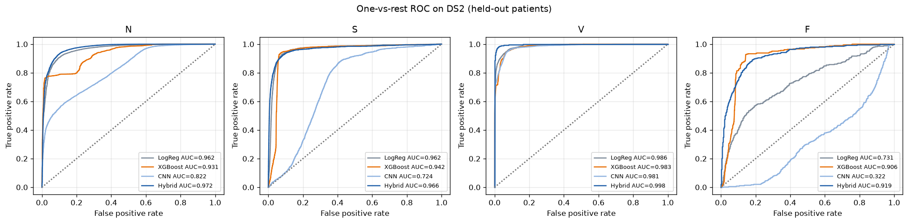
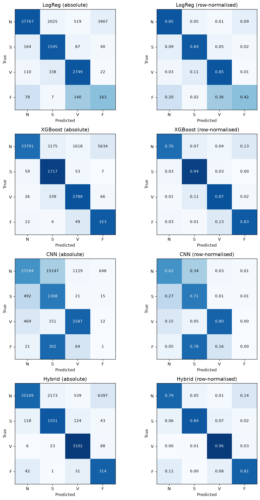
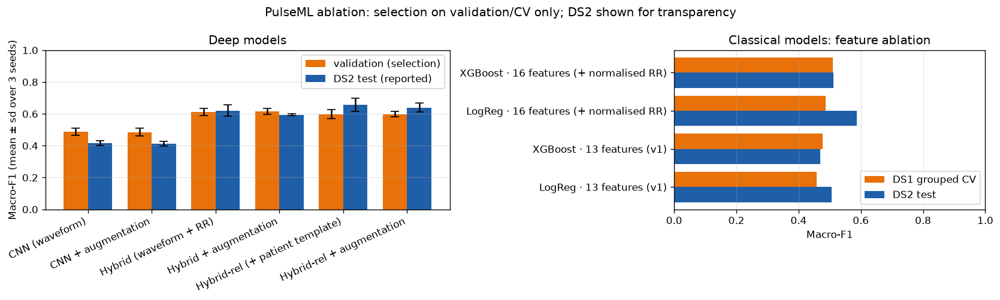
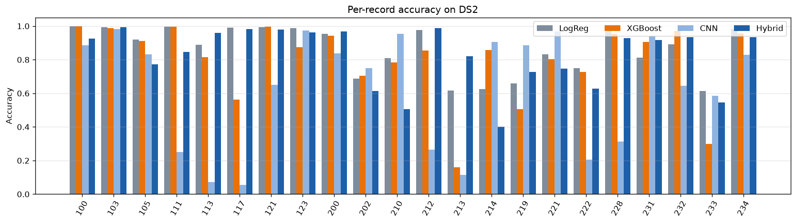
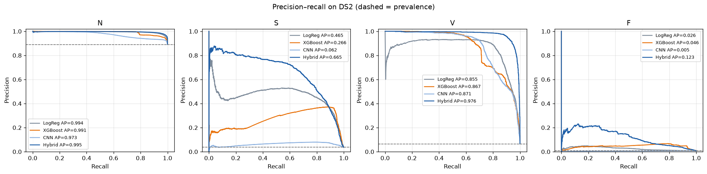
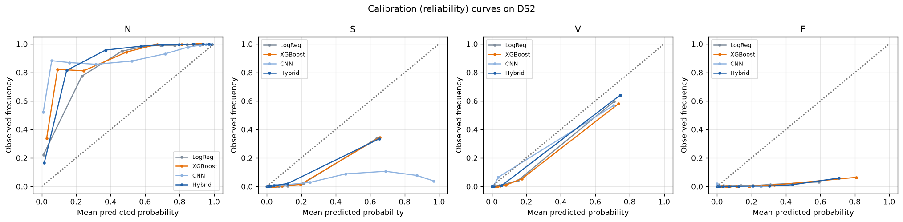
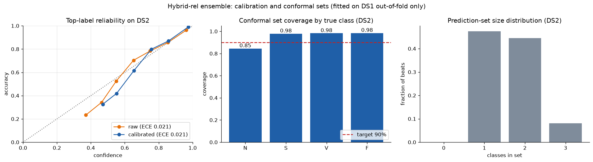

# PulseML

**End-to-end ECG arrhythmia pipeline: PhysioNet ingestion → validated Parquet feature store → patient-level ML training and ablations → evaluation & model card → FastAPI + Streamlit serving.**

[](https://github.com/sriramachellu/PulseML/actions/workflows/ci.yml)


> ⚠️ **Responsible use.** This is an educational research prototype. It is not a medical device, not FDA-cleared, and must not be used for clinical diagnosis or patient care.

PulseML classifies individual heartbeats from the [MIT-BIH Arrhythmia Database](https://physionet.org/content/mitdb/1.0.0/) into the four AAMI EC57 classes: **N** (normal), **S** (supraventricular ectopic), **V** (ventricular ectopic) and **F** (fusion). It uses the **de Chazal inter-patient split**, so no patient contributes beats to both training and test data.

### Headline result (22 unseen patients, 49,661 beats)

| Model | Macro-F1 | Macro-AUC | S recall | V recall | F recall |
|---|---|---|---|---|---|
| Specified 1D CNN (waveform only) | 0.408 | 0.712 | 0.71 | 0.80 | 0.00 |
| Logistic regression (16 engineered features) | 0.586 | 0.910 | 0.84 | 0.85 | 0.42 |
| **Recommended: Hybrid-rel CNN ensemble** (beat + deviation from the patient's own template + patient-normalised RR) | **0.603** | **0.964** | 0.85 | **0.96** | 0.81 |

The recommended model came from four documented iterations, with **every selection decision made without test data**. See [docs/EXPERIMENTS.md](docs/EXPERIMENTS.md).

---

## Documentation

| Document | Contents |
|---|---|
| [docs/PulseML_Walkthrough.pdf](docs/PulseML_Walkthrough.pdf) | 36-slide visual walkthrough for learners: dataset, every pipeline step with real code explained line by line, why each model, results, how to run it |
| [docs/METHODOLOGY.md](docs/METHODOLOGY.md) | Exact signal processing, labels, the 16 features, splits, models, metrics and reproducibility |
| [docs/EXPERIMENTS.md](docs/EXPERIMENTS.md) | Iteration log: baseline → split bug fix → normalised RR + hybrid → patient template → CV-based selection, with every number |
| [docs/FUTURE_WORK.md](docs/FUTURE_WORK.md) | Weaknesses, alternative models (MiniRocket, ResNet/InceptionTime, sequence models, Siamese, foundation models), data roadmap, MLOps, regulatory path, prioritised next steps |
| [docs/API.md](docs/API.md) | REST API reference: routing, schemas, examples, privacy-preserving logging |
| [model_card.md](model_card.md) | Auto-generated model card: metrics, ablation, limitations, ethics, bias, PHI handling |
| `outputs/reports/data_quality.html` | Data-quality report (lineage, class balance, checks, DuckDB analytics) |

---

## Architecture

```
                 ┌──────────────────────────── Data pipeline ─────────────────────────────┐
 PhysioNet ──►   │ src/download.py   wfdb.dl_database('mitdb') → data/raw/*.dat|hea|atr   │
 (48 records)    │        ▼                                                               │
                 │ src/preprocess.py  drop paced (102,104,107,217) → 44 records           │
                 │   MLII by name → Butterworth 0.5–40 Hz (zero-phase)                    │
                 │   annotations → AAMI N/S/V/F (exclude /, f, Q, non-beats)              │
                 │   280-sample window @ R-peak → z-score; 16 features incl. causal       │
                 │   patient-normalised RR; de Chazal split → beats_ds1|ds2.parquet       │
                 │        ▼                                                               │
                 │ src/validate.py   quality checks + DuckDB SQL → data_quality.html|json  │
                 └────────┼───────────────────────────────────────────────────────────────┘
                          ▼
                 ┌──────────────────────────── Modelling (DS1 only) ──────────────────────┐
                 │ src/train.py        LogReg + XGBoost (record-grouped CV grid search)   │
                 │                     1D CNN (spec) · Hybrid-rel 3-seed ensemble          │
                 │ src/experiments.py  multi-seed ablation · 5-fold grouped CV selection  │
                 │ src/evaluate.py     DS2 metrics, ROC/PR/calibration/CM, per-patient,   │
                 │                     model_card.md                                      │
                 └────────┼───────────────────────────────────────────────────────────────┘
                          ▼
     ┌──────────────────────────────────┐      ┌──────────────────────────────────────────┐
     │ api.py (FastAPI)                 │      │ dashboard.py (Streamlit + Plotly)         │
     │ POST /predict  waveform          │      │ Data Explorer · Model Performance ·       │
     │   + rr_context → hybrid model    │      │ ablation · Live Prediction (CNN vs        │
     │   + patient_template (optional)  │      │ hybrid, saliency, TreeSHAP)               │
     │ GET /health · GET /model-info    │      └──────────────────────────────────────────┘
     └──────────────────────────────────┘            both read the shared outputs/ volume
```

### How the recommended model sees a beat

```
 beat (280 samples, z-scored) ──────────┐
                                        ├─► 2-ch Conv1d trunk (32→64→128, GAP) ─┐
 beat − patient's median of last 16 ────┘                                       ├─► MLP ─► N/S/V/F
 RR features: rr_prev, rr_next, ratio, HR, local mean RR,                       │   (× 3 seeds,
   rr_prev / local mean, rr_next / local mean ─► MLP (7→32→32) ─────────────────┘    softmax-averaged)
```

Everything patient-relative is **causal and label-free**: it uses only earlier beats from the same recording, so it's available at inference time in a streaming setting.

## Repository layout

```
pulseml/
├── src/
│   ├── config.py       # every constant, path, split and hyperparameter
│   ├── download.py     # PhysioNet fetch (idempotent)
│   ├── preprocess.py   # filtering, segmentation, AAMI mapping, features, Parquet
│   ├── validate.py     # data-quality checks, DuckDB analytics, HTML/JSON report
│   ├── dataset.py      # PyTorch Dataset over Parquet; causal patient templates
│   ├── models.py       # LogReg/XGBoost factories, ECGCNN, HybridCNN(-rel), SeedEnsemble
│   ├── train.py        # patient-level split, CV grid search, CNN/hybrid training, refit
│   ├── experiments.py  # multi-seed ablation + 5-fold grouped CV model selection
│   ├── evaluate.py     # DS2 metrics, figures, model card
│   ├── calibrate.py    # BCTS calibration + Mondrian conformal sets (fitted on DS1 OOF)
│   ├── templates/      # model card template filled in by evaluate.py
│   └── utils.py        # logging, seeding, hashing, JSON IO
├── api.py              # FastAPI inference service
├── dashboard.py        # Streamlit research dashboard
├── docs/               # methodology, experiments, future work, API reference
├── tests/              # 82 pytest tests (no data download needed)
├── outputs/            # models, figures, reports, Parquet (large feature store gitignored)
├── Dockerfile · docker-compose.yml · .github/workflows/ci.yml · pyproject.toml
└── model_card.md
```

## Quick start

```bash
git clone https://github.com/sriramachellu/PulseML.git && cd PulseML
python -m venv .venv && source .venv/bin/activate   # Windows: .venv\Scripts\activate
pip install -r requirements.txt
```

**GPU (optional):** pip installs the CPU PyTorch wheel by default on Windows. For CUDA, install the matching wheel, e.g. `pip install torch --index-url https://download.pytorch.org/whl/cu126`. Training uses CUDA automatically when it's available. On an RTX 3060 one CNN epoch takes ~1.5 s, vs ~6 s on CPU.

Trained models, reports, figures, DS2 predictions and a 400-beat demo sample are committed, so the API and dashboard run immediately:

```bash
uvicorn api:app --reload            # http://localhost:8000/docs
streamlit run dashboard.py          # http://localhost:8501
```

To reproduce everything from raw data (~100 MB download):

```bash
python -m src.download                      # 1. fetch 48 MIT-BIH records from PhysioNet
python -m src.preprocess                    # 2. Parquet feature store (~1 min)
python -m src.validate                      # 3. data-quality report + DuckDB analytics
python -m src.train                         # 4. LogReg, XGBoost, CNN, Hybrid-rel ensemble (~2 min GPU)
python -m src.evaluate                      # 5. DS2 evaluation, figures, model_card.md
python -m src.calibrate                     # 6. calibration + conformal sets from DS1 OOF (~10 min GPU)
python -m src.experiments                   # 7. (optional) multi-seed ablation (~15 min GPU)
python -m src.experiments --cv-select       # 8. (optional) 5-fold grouped CV selection (~10 min GPU)
pytest tests/ -v                            # 9. test suite
```

## Command reference

| Command | What it does | Outputs |
|---|---|---|
| `python -m src.download [--force]` | Downloads any missing `.dat/.hea/.atr` files for the 48 records | `data/raw/` |
| `python -m src.preprocess` | Excludes paced records; MLII lead; 0.5–40 Hz 4th-order Butterworth (`sosfiltfilt`); AAMI mapping; 280-sample windows; z-score; 16 features; de Chazal split. Logs per-record and per-stage counts | `outputs/parquet/beats_ds{1,2}.parquet`, `pipeline_stats.parquet`, `outputs/reports/preprocess_summary.json` |
| `python -m src.validate` | Missing values, ±5 mV amplitude, flat signal, duplicate keys/waveforms, label validity, DS1/DS2 leakage; DuckDB SQL (class distribution, record aggregates, class×record pivot, HR by class) | `outputs/reports/data_quality.{html,json}`, `class_distribution.png`, `feature_correlation.png` |
| `python -m src.train [--max-epochs N] [--skip-baselines] [--skip-cnn] [--skip-hybrid]` | Grid-searched LogReg/XGBoost (record-grouped CV); specified CNN (early stopping); Hybrid-rel 3-seed ensemble refit on all DS1 | `outputs/models/*.joblib`, `cnn_best.pt`, `hybrid_best.pt`, `training_metadata.json`, `cnn_training_curves.png` |
| `python -m src.evaluate` | All models on DS2: per-class precision/recall/F1/specificity, macro/weighted F1, AUC, curves, per-record flags | `outputs/reports/evaluation_metrics.json`, `model_comparison.csv`, `per_record_metrics.csv`, `outputs/figures/*.png`, `model_card.md`, `demo_beats.parquet` |
| `python -m src.calibrate [--reuse-oof]` | Re-runs the final recipe in 5 record-grouped folds on DS1, fits temperature / BCTS by NLL and Mondrian conformal thresholds (α = 0.1) on the out-of-fold predictions, then reports on DS2 | `outputs/models/calibration.json`, `outputs/reports/calibration_report.json`, `oof_hybrid_logp.npz`, `outputs/figures/hybrid_calibration.png` |
| `python -m src.experiments` | 6 deep variants × 3 seeds + classical feature ablation; selection on validation, DS2 reported for transparency | `outputs/reports/experiments.{csv,json}`, `outputs/figures/ablation.png` |
| `python -m src.experiments --cv-select` | 5-fold record-grouped CV between the hybrid variants (pooled out-of-fold macro-F1) | `outputs/reports/experiments_cv.{csv,json}` |

### API in one call

```bash
curl localhost:8000/health
curl -X POST localhost:8000/predict -H "Content-Type: application/json" -d @beat.json
```

`beat.json` holds `{"waveform": [280 floats], "rr_context": {"rr_prev_ms": 620, "rr_next_ms": 1050, "rr_local_avg_ms": 830}, "patient_template": [280 floats]}`. Only `waveform` is required; with `rr_context` the recommended hybrid model answers. Every response carries `X-Disclaimer: Research demonstration only. Not for clinical use.` Logs contain an input hash, never the waveform. Full reference: [docs/API.md](docs/API.md).

## Results

All numbers are on **DS2** (49,661 beats: 44,218 N · 1,836 S · 3,219 V · 388 F) from patients never used for training, hyperparameter search, early stopping or model selection.

| Model | Accuracy | Macro-F1 | Weighted-F1 | Macro-AUC | N rec. | S rec. | V rec. | F rec. |
|---|---|---|---|---|---|---|---|---|
| LogReg (16 features) | 0.850 | 0.586 | 0.890 | 0.910 | 0.854 | 0.842 | 0.854 | 0.420 |
| XGBoost (16 features) | 0.778 | 0.543 | 0.836 | 0.941 | 0.764 | 0.935 | 0.866 | 0.832 |
| CNN (specified) | 0.628 | 0.408 | 0.723 | 0.712 | 0.617 | 0.712 | 0.804 | 0.003 |
| **Hybrid-rel ensemble** | 0.807 | **0.603** | 0.865 | **0.964** | 0.794 | 0.845 | **0.964** | 0.809 |

### How we got there

| Iteration | Change | Effect (selection metric → DS2) |
|---|---|---|
| 0 | Specified pipeline: LogReg/XGBoost on 13 features, CNN on the waveform | CNN val 0.46 → DS2 0.41 |
| 1 | **Bug fix:** the validation split had taken record 208 (90% of F beats) out of training; replaced with a class-preserving record search | F beats in training: 37 → 380 |
| 2 | **Patient-normalised RR** features + **Hybrid CNN** + augmentation | LogReg DS2 0.51 → 0.59; Hybrid val 0.61 / DS2 0.62 (3 seeds) |
| 3 | **Patient template channel** (beat − median of previous 16 beats) | Val 0.60 (tie) / DS2 0.64–0.66 |
| 4 | **5-fold grouped CV** replaces the noisy 4-patient validation for the final choice; refit on all DS1 with a 3-seed ensemble | Hybrid-rel + aug selected (CV 0.583) → DS2 0.603, AUC 0.964 |
| 5 | **Calibration (BCTS) + Mondrian conformal sets**, fitted on DS1 out-of-fold predictions | DS2 NLL 0.477 → 0.158, Brier 0.273 → 0.078; 90%-target sets cover 86% (mean size 1.6) |

**Takeaways**
* Honest inter-patient numbers are far below the >99% often quoted for MIT-BIH; those come from beat-level splits that leak patients.
* **Context relative to the patient** (rhythm and morphology) is what generalises. Model capacity isn't: XGBoost kept choosing its smallest trees.
* V is reliably detected (recall 0.96, AUC 0.998). **S precision (0.41)** and **F precision (~0.05)** remain the open problems. See [docs/FUTURE_WORK.md](docs/FUTURE_WORK.md).
* Model-selection noise is about as large as the effects being measured, so all decisions use multi-seed or grouped-CV evidence, and one protocol change is openly disclosed.

| | |
|---|---|
|  |  |
|  |  |
|  |  |

### Calibrated probabilities and prediction sets

`python -m src.calibrate` fits bias-corrected temperature scaling (BCTS) and class-conditional split-conformal
thresholds on **DS1 out-of-fold** predictions, then reports on DS2. The API returns calibrated `probabilities`, the
`raw_probabilities`, and a `prediction_set` (e.g. `["N", "S"]`) targeting 90% coverage per class. Labels still come
from the raw argmax, because BCTS alone would almost never predict S or F. On DS2 the sets cover 86% of beats
(S/V/F ≈ 98%, N 84.5%): the guarantee weakens on new patients, which is documented rather than hidden.



**Data quality:** 44 records → 103,724 annotations → 100,733 beat annotations → **100,630 beats** (15 excluded as paced/unclassifiable, 88 first/last beats with no RR neighbour). No missing values, flat beats, amplitude violations, duplicate keys or DS1/DS2 record overlap; 80 beats are flagged (not removed) for RR > 3 s, mostly genuine sinus pauses in record 232.

## Methodology: the decisions that matter

1. **Patient-level splitting is mandatory.** DS1 trains; DS2 is read only for reporting. Grid search uses `StratifiedGroupKFold` by `record_id`; neural validation and the final CV hold out whole patients.
2. **Class imbalance.** ~90% of beats are N. Inverse-frequency weighted cross-entropy (CNNs), balanced sample weights (XGBoost), `class_weight="balanced"` (LogReg). Selection and early stopping use **macro-F1**; accuracy is never reported alone.
3. **No hidden test-set tuning.** Every variant was chosen on validation or grouped CV; DS2 for all variants is published for transparency.
4. **Medical disclaimers everywhere:** API body and header, dashboard banners, model card, README, LICENSE.
5. **Reproducibility:** global seed 42 plus seeded generators; re-running reproduced validation/DS2 scores exactly. Lineage counts, data and model SHA-256 hashes, and full training metadata are saved.
6. **No PHI:** MIT-BIH is public and de-identified. The model card describes how PHI would be handled in a real deployment.

Details: [docs/METHODOLOGY.md](docs/METHODOLOGY.md).

## Deployment

**Docker (API + dashboard):**

```bash
docker compose up --build
# API → http://localhost:8000/docs   Dashboard → http://localhost:8501
```

Both services share `outputs/` as a read-only volume, so retraining on the host and restarting the containers picks up new models. The image uses CPU-only PyTorch, runs as a non-root user and has a `/health` healthcheck. Verified with Docker 29.7: both containers report healthy, and the CPU container reproduces the GPU-trained offline predictions on all 400 demo beats (labels and raw probabilities), with calibration loaded.

**Render (API):** create a *Web Service* from the repo, choose the *Docker* runtime and set the health-check path to `/health`. The container listens on `$PORT` when Render sets it (default 8000).

**Streamlit Community Cloud (dashboard):** *New app* → this repo → main file `dashboard.py`, Python 3.11. The committed models, reports, figures, `demo_beats.parquet` and `ds2_predictions.parquet` let every page work without raw data.

## Model card summary

See [`model_card.md`](model_card.md). A 3-seed ensemble of a 2-channel hybrid CNN (beat + deviation from the patient's template beat + patient-normalised RR features), trained on 22 MIT-BIH patients and evaluated on 22 others. Intended for **research and education only**. Key limitations: small single-centre 1975–79 cohort, single lead, relies on expert-annotated R-peaks, needs ~30 s of rhythm history for patient-relative inputs, F class unreliable, not validated on any independent population; calibrated probabilities and 90% prediction sets lose coverage on new patients (86% on DS2).

## Responsible-use statement

**This is an educational research prototype. It is not a medical device, not FDA-cleared, and must not be used for clinical diagnosis or patient care.**

## Citation

If you use this code, please cite the underlying data:

- Moody GB, Mark RG. The impact of the MIT-BIH Arrhythmia Database. *IEEE Engineering in Medicine and Biology* 20(3):45–50 (May–June 2001). PMID: 11446209
- Goldberger AL, Amaral LAN, Glass L, Hausdorff JM, Ivanov PCh, Mark RG, Mietus JE, Moody GB, Peng C-K, Stanley HE. PhysioBank, PhysioToolkit, and PhysioNet: Components of a new research resource for complex physiologic signals. *Circulation* 101(23):e215–e220 (2000).
- de Chazal P, O'Dwyer M, Reilly RB. Automatic classification of heartbeats using ECG morphology and heartbeat interval features. *IEEE Trans Biomed Eng* 51(7):1196–1206 (2004).

## License

[MIT](LICENSE)
